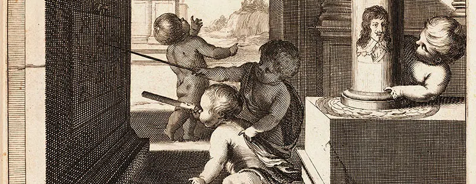
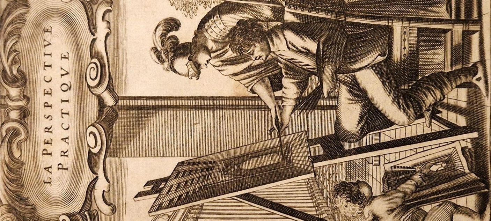
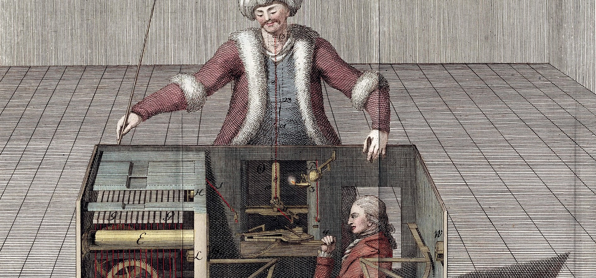

# Labs

## Lab 1: Elements of Tensors

## Lab 3: Tensor++ and Matrix Decompositions

<small>La perspective curieuse (Jean-François Niceron 1638)</small>

- Extend `Tensor` which we developed in [Chapter 2.1 Virtualizing Shapes with Strides](./1.md#21-virtualizing-shapes-with-strides), [Chapter 2.2 Accelerating Basic Linear Algebra on CPUs](./1.md#22-accelerating-basic-linear-algebra-on-cpus) with native implementations of the operations from Lab 1
- Extend `borscht.linalg.solve()` which we developed in [Chapter 2.3 From Performance Primitives to Linear Solvers](./1.md#23-from-performance-primitives-to-linear-solvers) with matrix decompositions

## Lab 4: Accelerating Matmul with Tiles and Layouts

<small>La Perspective practique (Jean Du Breuil 1642)</small>

- Extend `Tensor.__matmul__` which we developed in [Chapter 2.4 Accelerating Matrix Multiplication on GPUs](./1.md#24-accelerating-matrix-multiplication-on-gpus) with an alternatively accelerated matrix multiplication using cuteDSL

## Lab 6: Vision Language Action Model

## Lab 7: Custom Autograd Backwards for VLA

<small>Pamphlet on the Turk (Joseph Friedrich von Racknitz 1789)</small>

- Extend `Tensor.backward()` which we developed in [Chapter 4.1 Automatic Differentiation](./2.md#41-automatic-differentation) with accelerated VLA operations from Lab 6