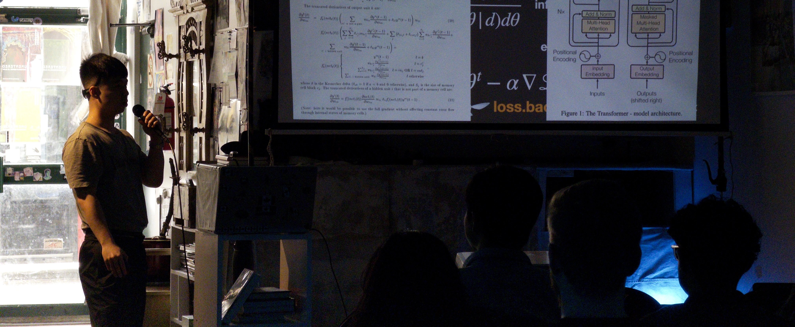

# Singularity Systems Syllabus

Welcome to Singularity Systems, the online course for a self-guided accelerated introduction to deep neural networks and deep learning systems. This page is the syllabus for the course, which consists of lectures, a textbook*All text (every single word) has been written by a human, for a human, as this book is not a reference book, but rather a cognitive helmet of understanding for a human. You are highly encouraged if not expected to read with an LLM, but be aware (that is, to beware) of how much you cognitively offload and outsource your understanding.*, and labs.
If you are interested in learning about the course's philosophy, jump below to the [course thesis](#course-thesis).

## Syllabus

- [Week 1. Hello Tensor 👋](#week-1-hello-tensor-)
- [Week 2. I Perceive You 👀](#week-2-i-perceive-you-)
- [Week 3. MetaCircularEvaLuAtor! ↩️](#week-3-metacircularevaluator-️)
- [Week 4. GPUs Go Brrr 🏎️](#week-4-gpus-go-brrr-️)
- Week 5. King - Man + Queen = 👩 (SOON)
- Week 6. Plato's Cave 𐦂𖨆𐀪𖠋 (SOON)
- Week 7. AutoNabla (≧∇≦) (SOON)
- Week 8. Don't Think 🤔 (TBD)
- Week 9. Just Do 🏃‍♂️ (TBD)
- Week 10. Compilers, They're InTense 😰 (TBD)

**Week 1. Hello Tensor 👋**

In week 1, you will be gently introduced to language modeling with the bigram model,
using the stochastic and infinitely continuous software 2.0 programming language  `borscht.Tensor`. You will need to watch one lecture, read two chapters, and write one lab.

- Watch [▶️ Lecture 1: Hello Tensor]()
- Read [📖 Chapter 1.1 From Certain to Uncertain Knowledge](./1.md#11-from-certain-to-uncertain-knowledge)
- Read [📖 Chapter 1.2 Next Token Prediction is Classification and Compression](./1.md#12-next-token-prediction-is-classification-and-compression)
- Write [✍️ Lab 1. Elements of Tensors]()

Optional reading consists of SITP's Intermezzo chapters, which formalizes the notions of uncertainty from probability,
as well as historical papers that first introduced statistical language modeling.

- Read [📖 Intermezzo 1.1 From Programs to Proof](./1.md#i11-from-programs-to-proof)
- Read [📖 Intermezzo 1.4 Probability Spaces and Distributions](./1.md#i14-probability-spaces-and-distributions)
- Read [An Example of Statistical Investigation of the Text Eugene
Onegin Concerning the Connection of Samples in Chains (Markov 1913)](https://alpha60.de/research/markov/DavidLink_AnExampleOfStatistical_MarkovTrans_2007.pdf)
- Read [A Mathematical Theory of Communication (Shannon 1948)](https://people.math.harvard.edu/~ctm/home/text/others/shannon/entropy/entropy.pdf)
- Read [A Proposal for the Dartmouth Summer Research Project on Artificial Intelligence (McCarthy et al. 1955)](http://jmc.stanford.edu/articles/dartmouth/dartmouth.pdf)

> Note: reading SITP Chapter 1.1 and Chapter 1.2 consists of watching four embedded lectures from Stanford CS109 Probability for Computer Scientists.
> - Watch Embedded [Stanford CS109 Probability for Computer Scientists Lecture 3: What is Probability?](./1.md#probability)
> - Watch Embedded [Stanford CS109 Probability for Computer Scientists Lecture 6: Random Variables and Expectation](./1.md#random-variable-1)
> - Watch Embedded [Stanford CS109 Probability for Computer Scientists Lecture 11: Joint Distributions](./1.md#joint-distribution)
> - Watch Embedded [Stanford CS109 Probability for Computer Scientists Lecture 4: Conditional Probability and Bayes](./1.md#conditional-distribution)

**Week 2. I Perceive You 👀**

In week 2, you will be introduced to the workhorse model of machine learning, the perceptron.
The perceptron forms a single neuron in a neural network.
You will need to watch one lecture, read two chapters, and write one lab.

- Watch [▶️ Lecture 2: I Perceive You]()
- Read [📖 Chapter 1.3 Parameterizing Classification with Discriminant Functions](./1.md#13-parameterizing-classification-with-discriminant-functions)
- Read [📖 Chapter 1.4 Parameterizing Classification with Probabilistic Models](./1.md#14-parameterizing-classification-with-probabilistic-models)
- Write [✍️ Lab 2.]()

Optional reading consists of continuing to read SITP's Intermezzo chapter,
which formalizes the notion of dimensionality from linear algebra, as well as historical papers on the perceptron, and statistical modeling.

- Read [📖 Intermezzo 1.2 From Programs to Proof](./1.md#i12-from-generics-to-algebras)
- Read [📖 Intermezzo 1.3 Vector Spaces and Linear Transformations](./1.md#i13-vector-spaces-and-linear-transformations)
- Read [The Perceptron: A Probabilistic Model for Information Storage and Organization in the Brain (Rosenblatt 1958)](https://homepages.math.uic.edu/~lreyzin/papers/rosenblatt58.pdf)
- Read [Statistical Modeling: The Two Cultures (Breiman 2001)](https://www2.math.uu.se/~thulin/mm/breiman.pdf)
- Read [The Epic Story of Maximum Likelihood (Stigler 2008)](https://arxiv.org/pdf/0804.2996)

> Note: reading SITP Chapter 1.3 and Chapter 1.4 consists of watching four embedded lectures from Stanford CS109 Probability for Computer Scientists.

**Week 3. MetaCircularEvaLuAtor! ↩️**

In week 3, you will be implementing your own  `borscht.Tensor`
which will run the bigram and perceptron model you trained in the first two weeks.
This implementation of `borscht.Tensor` will be incrementally evolved to support GPU acceleration, and training deep neural networks.
You will  need to watch one lecture, read three chapters, and write one lab.

- Watch [▶️ Lecture 3: MetaCircularEvaLuAtor!]()
- Read [📖 Chapter 2.1 Virtualizing Shapes with Strides](./1.md#21-virtualizing-shapes-with-strides)
- Read [📖 Chapter 2.2 Accelerating Basic Linear Algebra on CPUs](./1.md#22-accelerating-basic-linear-algebra-on-cpus)
- Read [📖 Chapter 2.3 From Performance Primitives to Linear Solvers](./1.md#23-from-performance-primitives-to-linear-solvers)
- Write [✍️ Lab 3. Tensor++ and Matrix Decompositions](./lab.md#lab-3-tensor-and-matrix-decompositions)

Optional reading consists of reading historical papers on array programming languages and numerical scientific computing.

- Read [A Set of Level 3 Basic Linear Algebra Subprograms (Dongarra et al. 1990)](https://dl.acm.org/doi/pdf/10.1145/77626.79170)
- Read [Anatomy of High-Performance Matrix Multiplication (Goto and van de Geijn 2008a)](https://www.cs.utexas.edu/~flame/pubs/GotoTOMS_revision.pdf)
- Read [The History of Fortran I, II, and III (Backus 1978)](https://softwarepreservation.computerhistory.org/FORTRAN/paper/p165-backus.pdf)
- Read [A History of MATLAB (Moler and Little 2020)](https://dl.acm.org/doi/pdf/10.1145/3386331)
- Read [Array Programming with NumPy (Harris et al. 2020)](https://www.nature.com/articles/s41586-020-2649-2)

**Week 4. GPUs Go Brrr 🏎️**

In week 4, you will be accelerating the implementation of  `borscht.Tensor`
by implementing GPU kernels. You will need to watch one lecture, read one chapter, and write one lab.

- Watch [▶️ Lecture 4: GPUs Go Brrr]()
- Read [📖 Chapter 2.4 Accelerating Matrix Multiplication on GPUs](./1.md#24-accelerating-matrix-multiplication-on-gpus)
- Write [✍️ Lab 4. Accelerating Matmul with Tiles and Layouts](./lab.md#lab-4-accelerating-matmul-with-tiles-and-layouts)

**Week 5. King - Man + Queen = 👸**

*Modeling Language with Multi Layer Perceptrons*

- Watch [▶️ Lecture 5]()
- Read [📖 Chapter 3.1 Learning Static Representations with FFNs](./2.md#31-learning-static-representations-with-ffns)
- Read [📖 Chapter 3.2 Iterative Optimization](./2.md#32-iterative-optimization)
- Write [Lab 5. Embedding Projector]()

**Week 6. Plato's Cave 𐦂𖨆𐀪𖠋**

*Modeling Language with Conv Nets, Recurrent Nets, and Transformers*

- Watch [▶️ Lecture 6]()
- Read [📖 Chapter 3.3 Learning Representations with CNNs](./2.md#33-learning-representations-with-cnns)
- Read [📖 Chapter 3.4 Learning Representations with RNNs](./2.md#34-learning-representations-with-rnns)
- Read [📖 Chapter 3.5 Learning Representations with GPTs](./2.md#35-learning-dynamic-representations-with-gpts)
- Write [✍️ Lab 6. Vision Language Action Model]()

**Week 7. AutoNabla (≧∇≦)**

*Implementing*  `borscht.Tensor.backward()`

- Watch [▶️ Lecture 7]()
- Read [📖 Chapter 4.1 Automatic Differentiation](./2.md#41-automatic-differentation)
- Read [📖 Chapter 4.2 Gradient Based Optimization](./2.md#42-gradient-based-optimization)
- Write [✍️ Lab 7. Custom Autograd Backwards for VLA](./lab.md#lab-7-custom-autograd-backwards-for-vla)

**Week 8. Don't Think 🤔 (TODO)**

*Reasoning Models (todo)*

**Week 9. Just Do 🏃‍♂️ (TODO)**

*Agents (todo)*

**Week 10. Compilers, They're InTense 😰 (TODO)**

*Tensor Compilers (todo)*

<small>*Presenting an early outline of SITP at [Toronto School of Foundation Modeling Season 1 (2025)](https://tsfm.ca/schedule)*</small>

## Course Thesis

<!-- todo
- curriculum. nanochat. muon optimizer. muon kernels.
- progressive closure, knuth's deliberate lying. -->

This book is aspirationally titled [*The Structure and Interpretation of Tensor Programs*](./front.md), (SITP)
as it's goal is to serve a similar role for software 2.0 as
[*The Structure and Interpretation of Computer Programs*](https://mitp-content-server.mit.edu/books/content/sectbyfn/books_pres_0/6515/sicp.zip/full-text/book/book.html)
(SICP) did for software 1.0.
Written by Harold Abelson and Gerald Sussman with Julie Sussman, SICP took learners on a whimsical whirlwind tour throughout the essence of computation
starting with the elements of programs with functional programming, higher order functions, data abstraction, streams,
and ending with programming their own programming languages with virtual interpreters and compilers to register machines.
Although perhaps somewhat more inconspicuous, there also exists [*The Structure and Interpretation of Classical Mechanics*](https://groups.csail.mit.edu/mac/users/gjs/6946/sicm-html/book.html) (SICM) (Sussman and Wisdom 2001) and [*Functional Differential Geometry*](https://library.oapen.org/handle/20.500.12657/26057) (FDG) (Sussman and Wisdom 2013) which cover classical and quantum mechanics of physics respectively.
We imagine that the next text would perhaps cover not thermodynamics, but rather deep learning.
We thus present [*The Structure and Interpretation of Tensor Programs*](./front.md) (SITP).

<blockquote class="twitter-tweet" data-conversation="none" data-width="300">
1.5k lines of rust and 100 commits later, we can now inference the FFN neural language model from (Bengio et al. 2003) straight from Karpathy&#39;s Zero to Hero. all you have to do is replace the single &quot;import torch&quot; line with &quot;import picograd&quot; 😎
&mdash; j4orz (@j4orz) <a href="https://x.com/j4orz/status/1907452857248350421?ref_src=twsrc%5Etfw">April 2, 2025</a></blockquote>

My alma matter was amongst those which took the SICP approach, and as intended,
for someone coming into first year college have taken some elementary computer science courses from high school, it blew my mind (Lambda Calculus!).
After graduating college in 2022, I followed my curiosity for diving deeper into the souls of our machine by going on to developing industrial languages and
runtimes.*"There is only one project, architecture, operating system and languages, compiler, it's only one project. It's all together." -- Boris Babayan*.
Particularly, I hacked on languages with [domain specific cloud compilers](https://www.infoq.com/presentations/deploy-pipelines-coinbase/)
and runtimes with [cloud provisioners, and cloud garbage collectors](https://www.infoq.com/presentations/coinbase-terraform-earth/).
At the end of 2022 though, when ChatGPT was released by OpenAI my mind was blown twice more.
As someone programming for some time, I could not believe this at all.
After two more years of hacking on cloud languages and runtimes, I started my transition from
domain specific cloud compilers from GPS to TERRAFORM to domain specific tensor compilers from TORCH to TRITON.*It turns out there is effectively zero overlap except that they are both compilers in that they take some source program and produce some target program.*

The transition started with a tweet showcasing the beginnings of a tensor library evaluating the forward pass of a feed forward network
from Andrej Karpathy's [Neural Networks: Zero to Hero](https://karpathy.ai/zero-to-hero.html) course.
While it was illuminating to start implementing each individual torch call that the nets from `makemore` were making,
my knowledge felt quite fragmented as I personally forgot lots of foundation from college*Only remembering [Professor. West](https://www.math.uwaterloo.ca/%7Ejjwest/OfficeHours.htm)'s [juggling](https://www.youtube.com/watch?v=sy4g2W6NU1M), and [Professor. Wolczuk](https://wolczuk.com/)'s [Ukrainian floor dancing](https://www.youtube.com/results?search_query=dan+wolczuk+dancing)*,
and I wasn't sure how to bridge myself to industrial deep learning systems like `tinygrad`*Here's a PR I was able to land in tinygrad [making logsumexp numerically stable](https://github.com/tinygrad/tinygrad/pull/6921). It felt like I was contributing to LLVM without having taken a course on compiler construction to learn the basics of parsing, optimization, and lowering.*, `torch`, `jax`, `vllm`, and `sglang`.

Shortly after, I decided to take the plunge and started drinking from the firehose of deep learning canon:
Hastie et al., Murphy, Goodfellow et al., you name it.
The one thought I could not get out of my head was *where is the SICP for software 2.0*?
While I found two excellent resources on building your own torch-like autograd by Tianqi Chen's 10-414 Carnegie Mellon and Alexander Rush's CS5781 at Cornell,
I personally would have enjoyed a more unified resource that took me from math, to deep learning, to deep learning systems in a *single unbroken sequence of thought*,
and perhaps others would feel similarly. That is the genesis story for this book, whose central research question is the following: **What does the SICP for deep learning look like**?

<blockquote class="twitter-tweet" data-conversation="none" data-width="300">
We really could use a SICP for DL. We have the Little Lisper for DL (<a href="https://t.co/su31hFJeUe">https://t.co/su31hFJeUe</a>) but that&#39;s a different type of book entirely.
&mdash; Shriram Krishnamurthi (primary: Bluesky) (@ShriramKMurthi) <a href="https://x.com/ShriramKMurthi/status/2051049923617968353?ref_src=twsrc%5Etfw">May 3, 2026</a></blockquote>

Pur shortly, SITP, is a function that maps learners from the product type of
an introductory computer science book such as [DCIC (Fisler et al. 2025)](https://dcic-world.org/) and an introductory systems programming book such as [TRPL (Klabnik et al. 2026)](https://doc.rust-lang.org/book/) with experimental modifications [(Crichton et al. 2023)](https://rust-book.cs.brown.edu/experiment-intro.html)
to a frontier model report such as the frontier technical report of [The Llama 3 Herd of Models (Meta 2024)](https://arxiv.org/abs/2407.21783) and frontier systems book such as Hugging Face's [Ultra Scale Book (Tazi et al. 2025)](https://huggingface.co/spaces/nanotron/ultrascale-playbook).

$$
\begin{aligned}
\text{SITP}&: \href{https://dcic-world.org/}{\text{DCIC}} \times \href{https://rust-book.cs.brown.edu/}{\text{TRPL}} \to \href{https://arxiv.org/pdf/2407.21783}{\text{LLAMA3}} \times \href{https://huggingface.co/spaces/nanotron/ultrascale-playbook}{\text{USPB}} \\
\text{SITP} &:= \href{https://htdp.org/}{\text{HTDP}}(\href{https://www.stat.uchicago.edu/~lekheng/courses/309/books/Trefethen-Bau.pdf}{\text{NLA}}, \href{https://www.math.kent.edu/~reichel/courses/optimization/Numerical_Optimization.pdf}{\text{NO}}, \href{https://web.stanford.edu/~jurafsky/slp3/}{\text{SLP}}, \href{https://www.bishopbook.com/}{\text{DL}}, \href{http://incompleteideas.net/book/the-book-2nd.html}{\text{RL}}, \href{https://epubs.siam.org/doi/book/10.1137/1.9781611972078}{\text{TAODCP}}, \href{https://shop.elsevier.com/books/programming-massively-parallel-processors/hwu/978-0-443-43900-1}{\text{PMPP}})
\end{aligned}
$$

where the function $\text{HTDP}(\cdot)$ is the systematic and principled design of a curriculum implemented by chimera-like professors and lecturers whom are usually interested and capable in the intersection of both programming language theory (PLT) and computer science education (CSE). 
In the same way that we use non-intersective adjectives in the distinctions of fake gun vs gun, non-tight language model vs language model, there is also the teaching professor vs professor*"I think of the position as having “twice” the teaching and “half” the research as an assistant professor (of course individual approaches can and do differ!)." -- [@JoePolitz, September 5, 2024](https://x.com/JoePolitz/status/1831797256871375332)*.
That is, SITP applies the form of HTDP developed by such teaching professors to the substance of deep learning. What then, is such a form?

The [How to Design Programs](https://htdp.org/) HTDP text  *This was the actual text used at my alma matter. Thank you to [Professor Ragde](https://cs.uwaterloo.ca/~plragde/flaneries/) for bringing it over, and to [Professor Vasiga](https://cs.uwaterloo.ca/~tmjvasig/) for bringing it to life.* was also seminal in that it was the first computer science text to treat curriculum design *as* scientific research and an engineering problem [(Felleisen et al. 2004)](https://cs.brown.edu/people/sk/Publications/Papers/Published/fffk-htdp-vs-sicp-journal/), building *off* the shoulders of the giant that SICP (Abelson and Sussman 1996) is.

>  First, the book discusses explicitly how programs should be constructed. Second, to tame the complexity of programming, it defines a series of teaching languages based on Scheme that represent five distinct knowledge levels through which students pass during their first course. The levels correspond to the complexity of data definitions that the program design guidelines use. Third, the book uses exercises to reinforce the explicit guidelines on program design; few, if any, exercises are designed for the sake of domain knowledge. Finally, the book uses more accessible forms of domain knowledge than SICP. Because of this shift in emphasis, we gave our book the title How to Design Programs (HTDP).

<!-- *the concreteness fading [(Fyfe et al. 2014)](https://eric.ed.gov/?id=EJ1036777) of declarative concepts in mathematics [(Hestenes et al. 1992)](https://gwern.net/doc/science/physics/1992-hestenes.pdf)* by presenting  notions just in time by defining them by their context, and iteratively refining (progressive disclosure) such concepts from the informal to formal ending in HtDP-style Intermezzos*Which present the formal syntax and semantics of a language.*.

that *transfer [(Bransford and Schwartz 1999)](https://journals.sagepub.com/doi/abs/10.3102/0091732x024001061) to procedural skills of computation* [(Price et al. 2021)](https://www.lifescied.org/doi/pdf/10.1187/cbe.20-12-0276) in the context of deep learning. Such transfer is possible because the computational discipline of deep learning has lots of structural similarity with mathematics, and is why we have books such as [Deisenroth et al. (2020)](https://mml-book.github.io/), and subsequent courses follwing such book.

<iframe height="400px" width="100%" loading="lazy" src="https://www.youtube.com/embed/5c0BvOlR5gs?si=WpT3iVQbpjMMB6Ku"  title="YouTube video player" frameborder="0" allow="accelerometer; autoplay; clipboard-write; encrypted-media; gyroscope; picture-in-picture; web-share" referrerpolicy="strict-origin-when-cross-origin" allowfullscreen></iframe>

When it comes to the discipline of deep learning, there are two large jumps of *transfer* a learner must make.
The first one is that a learner must learn the mathematics *for* machine learning, while although elementary, has a non-trivial breadth of probability theory, linear algebra, differential calculus, and if the learner has the time,
to deepen such concepts with information theory, measure theory, and analysis.
One of the primary texts that seeks to provide a unified treatment in such mathematics *for* machine learning
is [(Deisenroth et al. 2020)](https://mml-book.github.io/)*"For instance, [Princeton's](https://www.cs.princeton.edu/courses/archive/spring21/cos302/) [COS302](https://www.youtube.com/playlist?list=PLCO4cUaBLHFEHo42HVIVWaSOvbAiH30uc) offered by Ryan Adams, which turns out to be the lab that created created [HIPS/autograd](https://github.com/hips/autograd) (led by Matthew Johnson, Dougal Maclaurin, and David Duvenaud), which inspired PyTorch! See [https://soumith.ch/blog/2023-12-17-pytorch-design-origins.md.html#/origins](https://soumith.ch/blog/2023-12-17-pytorch-design-origins.md.html#/origins)*., which provides an excellent two part structure
with the foundational mathematics, followed by the applied.
The core motivation is that any gaps in mathematics can be filled, preparing a learner for a text like
such [(Goodfellow et al. 2016)](https://www.deeplearningbook.org/) to deepen their understanding in neural network architecture.

More recently, with the advent of scaling large language models [(Kaplan et al. 2020)](https://arxiv.org/pdf/2001.08361)
and the slowing of Moore's Law [(Moore 1965)](http://cva.stanford.edu/classes/cs99s/papers/moore-crammingmorecomponents.pdf),
another jump of *transfer* the learner must make is how to efficiently map their architecture and optimizers to massively parallel hardware at the level of a single graphics processing unit (GPU) and multi GPU.
The two canonical texts for this are [(Hwu et al. 2022)](https://www.educate.elsevier.com/book/details/9780323912310) for systems, and more recently
[(Tazi et al. 2025)](https://huggingface.co/spaces/nanotron/ultrascale-playbook)*"Alternatively, JAX Scaling Book (link.)*.

As someone opening up PMPP, it was extremely frustrating to read the appendix that briefly covered the process of deep learning
without a proper foundation in the modeling of architecture and optimizers.

When I realized the two large jumps I was making from re-learning foundational mathematics to frontier architecture,
and from modeling frontier architecture to accelerating frontier architecture, my "aha" moment was realizing
the vast bridges a learner was being asked to cross, and realizing Shriram's taste of finding some intermediary point
to smoothen such a progression. This was the motivation for the explicit Design Recipe in HtDP to go from
blank page to a well-designed program, and more recently, property-based testing to go from unit tests to model checking and SAT solvers.
To return to the short description, SITP that maps learners from the product type of
an introductory computer science book and an introductory systems programming book
to a frontier model report such as the frontier technical report and frontier systems book.
That is,

$$\text{SITP}: \href{https://dcic-world.org/}{\text{DCIC}} \times \href{https://rust-book.cs.brown.edu/}{\text{TRPL}} \to \href{https://arxiv.org/pdf/2407.21783}{\text{LLAMA3}} \times \href{https://huggingface.co/spaces/nanotron/ultrascale-playbook}{\text{USPB}}$$

unity/intertwined mathematics and programming
- Evaluation (Benchmarks): Stochastics of probability theory $(\Omega, \mathcal{F}, \mathbb{P})$
- Specification (Architecture): Dimensionality of linear algebra $(V, \langle\cdot, \cdot\rangle)$
- Implementation (Optimizers): Approximation of differential calculus $\frac{d\mathscr{L}}{dw}$, $\nabla\mathscr{L}$, $\mathbb{J}$, $\mathbb{H}$
- Computation (Systems): Rooflines of processors $\text{max}(compute, communication)$

For instance, the traditional ordering one might approach to the discipline of deep learning is to *synthetically deduce* definitions starting from what is considered to be elementary (i.e your choice of foundations which you pay lip service to as a working mathematician: ZFC or DTT). The benefits of this approach is that the *transfer [(Bransford and Schwartz 1999)](https://journals.sagepub.com/doi/abs/10.3102/0091732x024001061)* of concepts is maximized — afterall, studying mathematics is simply generic programming. While this is no doubt the standard for most mathematical texts, this is what was special about the textbook How to Design Programs, an explicitly curriculum designed and engineered for transfer [(Felleisen et al. 2004)](https://cs.brown.edu/people/sk/Publications/Papers/Published/fffk-htdp-vs-sicp-journal/) expositing programming based off the principles of set theory (whatever that may mean).

all in the context of autoregressive language modeling, culminating in the transformers architecture -->

<!-- during a crisis, it's the Kairos (καιρός). the opportune moment.
we are living in the eye of the storm, and it's hard to predict what comes next.

- one case study: Shampoo/Muon, Muon Kernels (Tri Dao), CuTe Layout
- check afterword. check repo singsys for
  - gpt2 -> dsv3 -> k3
  - hopper, blackwell, rubin, feynman
- this book is a take on such a normative claim.
- not only does SITP cover AI, it uses AI
- https://www.coreauto.com/blog/when-ai-starts-writing-systems-code mlsys 2026 keynote

foo

- primary goal: understanding. but after understanding, automate yourself.
- in some sense, the intelligence revolution is simply an extension of the information revolution, not only in the information theoretical sense where next-token predicion can be viewed as compression, but also in the practical sense where we all first learned Python to automate something.
- everyone must start becoming research engineers. instantiate new patterns of bits or atoms into reality.
  - perhaps thats the next transformer with continual learning (core auto)
  - perhaps thats the next transformer with memory (engram)
  - perhaps thats the next theory of deep learning (learning mechanics)
  - perhaps thats the next deep learning framework (modula)
  - perhaps thats the next gpu (matx)
  - perhaps thats the next human assistant (thinking)
  - perhaps thats the next scientific assistant (periodic labs, isomorphic labs)
  - perhaps thats the next imaging (midjourney, art and medical)
  - perhaps thats the next digital physical (pragmatic)
  - perhaps thats the next education (eureka)
  - perhaps thats the next god with SSI
  - or perhaps it's curing cancer, or getting to mars
  - these are prompts that are not 1 shot -->

<!--

- the what (math) the how (computation) are equally important,
  moore's law, hardware software codesign, researchers writing kernels
  chapter 1 and 3 seem quite different than chapters 2 and 4, but they are really unified in this era of deep learning systems
  for research engineers, chapters 2 and 4 might be "the how", but they are really "the what" because performance matters.
- position paper by [Krishnamurthi and Fisler (2020)](https://cs.brown.edu/people/sk/Publications/Papers/Published/kf-data-centric/) which has been operationalized at the school-level with [Bootstrap:Data Science](https://www.bootstrapworld.org/materials/data-science/) and at the collegiate-level with [Data Centric Introduction to Computing](https://dcic-world.org/)
- explicit instruction, and a process for performing procedural skills
- The difference between design and research seems to be a question of new versus good. Design doesn't have to be new, but it has to be good. Research doesn't have to be good, but it has to be new.
- problem of exposition (3B1B quote)
- https://www.paulgraham.com/desres.html

- https://docs.divio.com/documentation-system/, there are lots of tutorials and how to guides,
some explanations. not many references. at the limit, this is my attempt at creating a canonical reference.
  - https://docs.python.org/3/ and https://docs.astral.sh/uv/guides/
  - https://doc.rust-lang.org/stable/
  - https://lean-lang.org/learn/

- torch and vllm is the linux of AI, where is the xv6?
- curriculum engineering, drscheme (racket): https://cs.brown.edu/people/sk/Publications/Papers/Published/fffkf-drscheme-journal/, pyret: https://pyret.org/pyret-code/
- the book's breadth is ambitious but we should expect ourselves to learn more with AI now. AI is the rocketship for our minds.
- alan kay, lisp's interpreter is like maxwells equations, everyone should also implement back propagation and a mingpt https://karpathy.github.io/2026/02/12/microgpt/, ./assets/lisp.png
- mark sarofim, golden age of systems,
linear algebra, numpy, and torch stood the test of time
- the only misnomer is that this is a book about torch, not jax
- use MIT and Standford because they are the standard when it comes to open course ware. i.e some MIT speedrunning Scott Young.
- lot of conceptual baggage
- karpathy as sensei. it's memey but it's the same as calling aristotle the first teacher.
this is why SITP heavily uses LLM101n
-->

Jeffrey Zhang 
Waterloo, Ontario 
August 2026 

<!-- (i.e Why another deep learning book?)

**Learning Outcomes (Tasks)**
learning probes, observable, signals, channels for feedback
interactive learning
-> no longer producing code (hieroglyphics)

[concept inventory (Hestenes et al. 1992)](https://gwern.net/doc/science/physics/1992-hestenes.pdf)

Software 2.0, following [(Krishnamurthi and Fisler 2020)](https://cs.brown.edu/people/sk/Publications/Papers/Published/kf-data-centric/)

- Lectures
- Readings (with concreteness fading following [(Fyfe et al. 2014)](https://eric.ed.gov/?id=EJ1036777)) (with interactive quizzes following [(Crichton and Krishnamurthi 2024)](https://willcrichton.net/#ck:profiling-learning)) with SITP
  - Declarative concepts
    - property based testing
    - tradeoff between x and y
    - system design/system invariants
- Labs (with Agentic Coding following [(Fisler et al. 2026)](https://cs.brown.edu/people/sk/Publications/Papers/Published/fkl-teach-nov-agentic-ai-era/))
  - Procedural skills
    - write a good design doc/test suite
    - code review
- centered around the Teaching Array Programming Language [`borscht.Tensor`]() with language levels following the form of [(Felleisen et al. 2004)](https://cs.brown.edu/people/sk/Publications/Papers/Published/fffk-htdp-vs-sicp-journal/paper.pdf) but with the substance of NETSOR and NETSOR$\top$ from [(Yang 2019)](https://arxiv.org/pdf/1910.12478) and [(Yang 2020)](https://arxiv.org/abs/2006.14548) as well as PTX, CUDA, CuTeDSL, Cutile.

Future Directions
- integrate a trimmed version of such curricula with highschool mathematics, following [(Felleisen and Krishnamurthi 2009)](https://cs.brown.edu/people/sk/Publications/Papers/Published/fk-why-cs-doesnt-matter/) and [Guzdial](https://computinged.wordpress.com/2019/10/04/computing-education-research-issues-in-task-specific-programming-precalculus-tsp-part-5-of-5/)
- collect profile data to suggest pedagogic interventions to imporove learner outcomes
- actually encapsulate language levels like racket-like `#lang` with julia metaprogramming
- map out the semantic space of language features with a Standard Model of APLs following [(Krishnamurthi 2008)](https://dl.acm.org/doi/pdf/10.1145/1480828.1480846) -->

