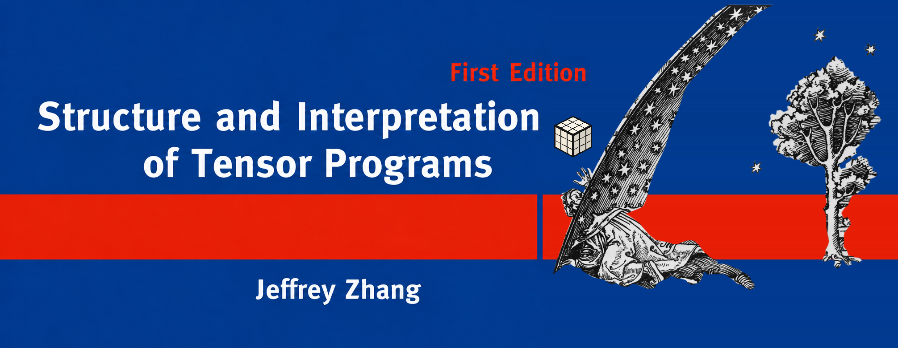

# Syllabus

Welcome to Singularity Systems, the online course for a self-guided study
which provides an accelerated introduction to deep learning networks and deep learning systems.

*All text (every single word) has been written by a human, for a human, as this book is not a reference book, but rather a cognitive helmet of understanding for a human. You are highly encouraged if not expected to read with an LLM, but be aware (that is, to beware) of how much you cognitively offload and outsource your understanding.* 

Course Offering (GPU MODE Discord)
- in-person crits
- design documents, specification

- [Lectures and Readings](#lectures-and-readings)
- [Assignments and Labs](#assignments-and-labs)
- [Course Design Thesis](#course-design-thesis)

## Lectures and Readings

### Lecture 1: Next-Token Prediction

Readings
- SITP [§1.1 From Certain to Uncertain Knowledge](./1.md#11-from-certain-to-uncertain-knowledge)
- SITP [§1.2 Next Token Prediction is Classification and Compression](./1.md#12-next-token-prediction-is-classification-and-compression)
- [An Example of Statistical Investigation of the Text Eugene
Onegin Concerning the Connection of Samples in Chains (Markov 1913)](https://alpha60.de/research/markov/DavidLink_AnExampleOfStatistical_MarkovTrans_2007.pdf)
- [A Mathematical Theory of Communication (Shannon 1948)](https://people.math.harvard.edu/~ctm/home/text/others/shannon/entropy/entropy.pdf)
- [A Proposal for the Dartmouth Summer Research Project on Artificial Intelligence (McCarthy et al., 1955)](http://jmc.stanford.edu/articles/dartmouth/dartmouth.pdf)

### Lecture 2: Parameter Estimation

Readings
- SITP [§1.3 Parameterizing Classification with Discriminant Functions](./1.md#13-parameterizing-classification-with-discriminant-functions)
- SITP [§1.4 Parameterizing Classification with Probabilistic Architectures](./1.md#14-parameterizing-classification-with-probabilistic-models)
- [The Perceptron: A Probabilistic Model for Information Storage and Organization in the Brain (Rosenblatt 1958)](https://homepages.math.uic.edu/~lreyzin/papers/rosenblatt58.pdf)
- [Statistical Modeling: The Two Cultures (Breiman 2001)](https://www2.math.uu.se/~thulin/mm/breiman.pdf)
- [The Epic Story of Maximum Likelihood (Stigler 2008)](https://arxiv.org/pdf/0804.2996)

### Lecture 3: The Parallel Tensor

Readings
- SITP [§2.1 Virtualizing Shapes with Strides](./1.md#21-virtualizing-shapes-with-strides)
- SITP [§2.2 Accelerating Basic Linear Algebra on CPUs](./1.md#22-accelerating-basic-linear-algebra-on-cpus)
- [A Set of Level 3 Basic Linear Algebra Subprograms (Dongarra et al., 1990)](https://dl.acm.org/doi/pdf/10.1145/77626.79170)
- [Anatomy of High-Performance Matrix Multiplication (Goto and van de Geijn 2008)](https://www.cs.utexas.edu/~flame/pubs/GotoTOMS_revision.pdf)
- [The History of Fortran I, II, and III (Backus 1978)](https://softwarepreservation.computerhistory.org/FORTRAN/paper/p165-backus.pdf)
- [A History of MATLAB (Moler and Little 2020)](https://dl.acm.org/doi/pdf/10.1145/3386331)
- [Array Programming with NumPy (Harris et al., 2020)](https://www.nature.com/articles/s41586-020-2649-2)

### Lecture 4: The Parallel Tensor Solver

Readings
- SITP [§2.3 From Performance Primitives to Linear Solvers]()
- SITP [§2.4 Accelerating Solvers with Decompositions]()

### Lecture 5: The Massively Parallel Tensor Solver

Readings
- SITP [§2.5 Accelerating Matrix Multiplication on GPUs]()

### Lecture 6: Learning Static Representations

### Lecture 7: Learning Dynamic Representations

### Lecture 8: Automatic Differentiation

### Lecture 9: Pre-training Parameterization and Optimization

## Assignments and Labs

### Lab 1: Foundational Elements

### Lab 2: Flaky Tensors

### Lab 3: Unstable Kernels

### Lab 4: Representations

### Lab 5: Hyperparameter Alchemy

### Lab 6: Autograd

### Lab 7: Nanochat

###  Lab 8: Tensor Compiler

## Course Design Thesis

(i.e Why another deep learning book?)

**Learning Outcomes (Tasks)**
learning probes, observable, signals, channels for feedback
interactive learning
-> no longer producing code (hieroglyphics)

Software 2.0, following [(Krishnamurthi and Fisler 2020)](https://cs.brown.edu/people/sk/Publications/Papers/Published/kf-data-centric/)

- "cure cancer"
- "go to mars"

- Lectures
- Readings (with concreteness fading following [(Fyfe et al.,)](https://eric.ed.gov/?id=EJ1036777)) (with interactive quizzes following [(Crichton and Krishnamurthi 2024](https://willcrichton.net/#ck:profiling-learning)) with SITP
  - Declarative concepts
    - property based testing
    - tradeoff between x and y
    - system design/system invariants
- Labs (with Agentic Coding following [(Fisler et al., 2026)](https://cs.brown.edu/people/sk/Publications/Papers/Published/fkl-teach-nov-agentic-ai-era/))
  - Procedural skills
    - write a good design doc/test suite
    - code review
- centered around the Teaching Array Programming Language [`borscht.Tensor`]() with language levels following the form of [(Felleisen et al., 2004)](https://cs.brown.edu/people/sk/Publications/Papers/Published/fffk-htdp-vs-sicp-journal/paper.pdf) but with the substance of NETSOR and NETSOR$\top$ from [(Yang 2021)](https://arxiv.org/pdf/1910.12478) and [(Yang 2020)](https://arxiv.org/abs/2006.14548) as well as PTX, CUDA, CuTeDSL, Cutile.

Future Directions
- integrate a trimmed version of such curricula with highschool mathematics, following [(Felleisen, Krishnamurthi 2009)](https://cs.brown.edu/people/sk/Publications/Papers/Published/fk-why-cs-doesnt-matter/) and [Guzdial](https://computinged.wordpress.com/2019/10/04/computing-education-research-issues-in-task-specific-programming-precalculus-tsp-part-5-of-5/)
- collect profile data to suggest pedagogic interventions to imporove learner outcomes
- actually encapsulate language levels like racket-like `#lang` with julia metaprogramming
- map out the semantic space of language features with a Standard Model of APLs following [(Krishnamurthi 2008)](https://dl.acm.org/doi/pdf/10.1145/1480828.1480846)