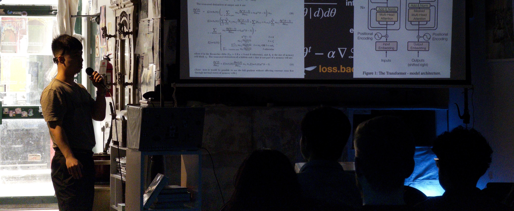

# Syllabus

> Any sufficiently advanced technology is indistinguishable from magic. <span class="sidenote-number"></span><span class="sidenote front-note">*Thanks, Arthur C. Clarke (1917-2008)*</span><br>

<div class="dropcap">

Welcome to SITP, the online course for a self-guided study
which provides an accelerated introduction to deep learning networks and deep learning systems.

</div>

<span class="sidenote-number"></span><span class="sidenote front-note">*All text (every single word) has been written by a human, for a human, as this book is not a reference book, but rather a cognitive helmet of understanding for a human. You are highly encouraged if not expected to read with an LLM, but be aware (that is, to beware) of how much you cognitively offload and outsource your understanding.*</span><br>

Course Offering (GPU MODE Discord)
- in-person crits
- design documents, specification

<div class="toc">

- [Lectures and Readings](#lectures-and-readings)
- [Assignments and Labs](#assignments-and-labs)
- [Course Design Thesis](#course-design-thesis)

</div>

## Lectures and Readings

### Lecture 1: Next-Token Prediction

Readings
- SITP [§1.1 From Certain to Uncertain Knowledge](./1.md#11-from-certain-to-uncertain-knowledge)
- SITP [§1.2 Next Token Prediction is Classification and Compression](./1.md#12-next-token-prediction-is-classification-and-compression)
- [An Example of Statistical Investigation of the Text Eugene
Onegin Concerning the Connection of Samples in Chains (Markov 1913)](https://alpha60.de/research/markov/DavidLink_AnExampleOfStatistical_MarkovTrans_2007.pdf)
- [A Mathematical Theory of Communication (Shannon 1948)](https://people.math.harvard.edu/~ctm/home/text/others/shannon/entropy/entropy.pdf)
- [A Proposal for the Dartmouth Summer Research Project on Artificial Intelligence (McCarthy et al., 1955)](http://jmc.stanford.edu/articles/dartmouth/dartmouth.pdf)

### Lecture 2: Parameter Estimation

Readings
- SITP [§1.3 Parameterizing Classification with Discriminant Functions](./1.md#13-parameterizing-classification-with-discriminant-functions)
- SITP [§1.4 Parameterizing Classification with Probabilistic Architectures](./1.md#14-parameterizing-classification-with-probabilistic-models)
- [The Perceptron: A Probabilistic Model for Information Storage and Organization in the Brain (Rosenblatt 1958)](https://homepages.math.uic.edu/~lreyzin/papers/rosenblatt58.pdf)
- [Statistical Modeling: The Two Cultures (Breiman 2001)](https://www2.math.uu.se/~thulin/mm/breiman.pdf)
- [The Epic Story of Maximum Likelihood (Stigler 2008)](https://arxiv.org/pdf/0804.2996)

### Lecture 3: The Parallel Tensor

Readings
- SITP [§2.1 Virtualizing Shapes with Strides](./1.md#21-virtualizing-shapes-with-strides)
- SITP [§2.2 Accelerating Basic Linear Algebra on CPUs](./1.md#22-accelerating-basic-linear-algebra-on-cpus)
- [A Set of Level 3 Basic Linear Algebra Subprograms (Dongarra et al., 1990)](https://dl.acm.org/doi/pdf/10.1145/77626.79170)
- [Anatomy of High-Performance Matrix Multiplication (Goto and van de Geijn 2008)](https://www.cs.utexas.edu/~flame/pubs/GotoTOMS_revision.pdf)
- [The History of Fortran I, II, and III (Backus 1978)](https://softwarepreservation.computerhistory.org/FORTRAN/paper/p165-backus.pdf)
- [A History of MATLAB (Moler and Little 2020)](https://dl.acm.org/doi/pdf/10.1145/3386331)
- [Array Programming with NumPy (Harris et al., 2020)](https://www.nature.com/articles/s41586-020-2649-2)

### Lecture 4: The Parallel Tensor Solver

Readings
- SITP [§2.3 From Performance Primitives to Linear Solvers]()
- SITP [§2.4 Accelerating Solvers with Decompositions]()

### Lecture 5: The Massively Parallel Tensor Solver

Readings
- SITP [§2.5 Accelerating Matrix Multiplication on GPUs]()

### Lecture 6: Learning Static Representations

### Lecture 7: Learning Dynamic Representations

### Lecture 8: Automatic Differentiation

### Lecture 9: Pre-training Parameterization and Optimization

## Assignments and Labs

### Lab 1: Foundational Elements

### Lab 2: Flaky Tensors

### Lab 3: Unstable Kernels

### Lab 4: Representations

### Lab 5: Hyperparameter Alchemy

### Lab 6: Autograd

### Lab 7: Nanochat

###  Lab 8: Tensor Compiler

## Course Design Thesis

> "Civilization advances by extending the number of important operations which we can perform without thinking of them." <span class="sidenote-number"></span><span class="sidenote front-note">*Thanks, Alfred North Whitehead (1861-1947)*</span><br>

<div class="full-bleed">

<div class="dual">


<div>

Management: Hey Alyssa P. Hacker, we suspect ClosedAI might be snooping on our research ideas we discuss with their models,
            namely the one high research project on building the first dyson sphere in order to reach the Andromeda Galaxy is top secret.
            We want to be in control of our own destiny, so we need you to train a good LLM,
            so here's 10k B200 GPUs for the month in order to prototype for a larger hero run.
            Moreover, as you know, we are hedging our Andromeda research efforts with the robotics arm of the company,
            and customers have been wanting the models to have a personality that grows like that one sci-fi film "Him"
            — so we need you to innovate on the architecture to get us every so closer towards such a vision,
            rather than simply copying ShallowPeak.
            Unfortunately, if the $100M training run diverges without any particularly useful learnings, we will have to fire you.
            Our board and shareholders need someone to be responsible.

Alyssa P. Hacker

Designing a neural network with an evolving personality.

Weighing growth mechanisms like slow traits versus expanding structure.

Checking whether project memory warrants a lookup first.

Designing trait vectors that modulate layers and expand over time.

Weighing PyTorch installation against a lightweight autograd alternative.

Considering JAX as a lighter-weight install than PyTorch.

Drafting FiLM-based layers that fold in growing trait vectors.

Tracing how new trait dimensions could gain real meaning.

Settling on three timescales: weights, traits, and moment-to-moment activity.

Designing a growth step that preserves existing network behavior.

Weighing a meta-learned hypernetwork to seed new trait dimensions.

Designing a simulated environment where personality mirrors a hidden niche.

Specifying surprise-driven growth and metrics for trait consistency.

Deciding whether to run the demo in PyTorch or JAX.

Searching for primary sources to ground design citations.

Drafting the synthetic world that drives trait growth.

Designing gated trait updates with surprise-aware stability biases.

Calibrating when accumulated surprise should trigger growth.

Settling on a fixed surprise threshold for triggering growth.

Untangling how random trait ordering could break symbol grounding.

Choosing a fixed onset order to keep trait meanings stable.

Defining metrics for stability, consistency, individuation, and experience.

Coding the synthetic world that generates niche-driven data.

Tuning signal strength so trait vectors stay informative.

Coding the behavior and integrator network modules.

Preventing runaway growth cascades after a trait dimension expands.

Writing the main training loop and evaluation metrics.

Adding developmental clocks so traits mature and resist shocks.

Testing twin lives and planning plots for personality trajectories.

---

Identifying research on persona vectors and personality traits.

Designing a JAX implementation of a growing trait vector network.

Coding the world simulator and model parameter setup.

Building the integration and gating logic for trait updates.

Wiring growth bookkeeping and lifetime simulation loop.

Estimating training runtime and outlining evaluation metrics.

Defining probe, shock, and PCA evaluation experiments.

Choosing hyperparameters and settings for the simulation code.

---

Benchmarking training speed across warmup and later steps.

Diagnosing why loss stays above the noise floor.

Evaluating whether the update rule can track trait signals.

Expanding network capacity to sharpen trait-tracking accuracy.

Weighing absolute versus relative thresholds for triggering growth.

---

Hitting a tool limit while trying to finalize file output.

Preparing a results summary without the generated files.

Condensing the full implementation into a compact inline version.

Writing out world-state sampling and parameter initialization routines.

Coding the behavior network and lifelong parameter update rules.

Assembling the training loop and meta-training driver.

</div>

<div>

Management: Hey Eva Lu Ator, we just tasked Alyssa P. Hacker to train our own in-house model.
            Our research in silicon photonics has allowed us to build a faster alternative to MVIDIA's GPUs,
            with machine speeds reaching YottaFLOP/S. We need you to implement our own deep learning framework and kernels
            that can support our chips and MVIDIA's as well in case we our fabrication yields don't hit targets.
            Also, if Alyssa P. Hacker's decides to explore new architectures or optimizers, we need you to implement the kernels.
            Notwithstanding hardware failures, if anything goes wrong with the software infrastructure during the \$100M training run,
            we will unfortunately have to fire you.
            Our board and shareholders need someone to be responsible.

Eva Lu Ator:
"implement pytorch"

```
> 7:22AM Let me first look at what's in the working directory to scope this.
> Thought for 432s

> 7:30AM The directory is empty and lacks numpy, torch, and pytest,
  so I'll build "nanotorch" — a NumPy-based PyTorch clone with a
  familiar API (Tensor, autograd, nn, optim, data loading, saving/loading), 
  testing against real PyTorch where possible. Starting with environment setup.
> Bash Check CPU count, memory, and Python package tooling
> Machine: 8-core M3 with 8GB RAM, so a workflow can run about 6 agents at once.
  Next I'll create a virtualenv with numpy and pytest, plus real PyTorch to use as the reference in tests.

> Bash Create virtualenv and install numpy and pytest
> Bash Install real PyTorch as a test oracle
> Thought for 2s

> Real PyTorch 2.14.1 is installed as the oracle.
  Before writing the design spec, I'll check a few numpy behaviours the core will depend on.
> Bash Verify numpy reshape/promotion features and torch promotion
> Thought for 607s

> Environment's set with numpy 2.5.4, pytest 9.1.1, and PyTorch 2.14.1 as the oracle.
  Now I'll verify the PyTorch behaviours against the real library before drafting the design contract.
> Bash Probe PyTorch semantics for the design spec
> These results match the spec I had planned. Next I'll write the design contract (docs/DESIGN.md)
  and pyproject.toml, and make the package importable from the venv.
> Write pyproject.toml
> Bash Make repo importable in venv and confirm torch sources exist

> 7:40AM Now the design contract. It's long on purpose: it pins down the core semantics
  and file ownership so parallel agents produce one coherent library.
> Write DESIGN.md
> Thought for 233s

> With the design contract done, I'll now build the core foundation
  first—Tensor, dtypes/type promotion, autograd, views/in-place ops, indexing,
  creation, random, test helpers, and the package skeleton—then subject
  it to five red-team reviews against real PyTorch with fixer rounds until tests pass,
  since everything else depends on this layer.
> Thought for 141s

> 7:50AM Workflow 1 is running in the background: one core implementer,
  then 5 red-team reviewers in parallel, then up to 3 fixer rounds.
  The core is the largest single piece, so this will take a while.
  I'll be notified when it finishes, then review the core myself
  before launching the 9 parallel op/nn families of Workflow 2.
```

</div>

</div>

</div>

> "Everything is vague to a degree you do not realize till you have tried to make it precise." <span class="sidenote-number"></span><span class="sidenote front-note">*Thanks, Bertrand Russel (1872-1970)*</span><br>

`DESIGN.md`

```markdown
# nanotorch — design and contributor contract

nanotorch is a from-scratch reimplementation of the PyTorch Python API on top of NumPy.
Code written for PyTorch should run unchanged with `import nanotorch as torch` for the
supported subset and produce the same results (up to floating-point rounding and RNG streams).

* **We implement:** tensor semantics (dtypes and type promotion, broadcasting, views,
  in-place ops, indexing), the autograd engine (dynamic graph, higher-order gradients,
  hooks, version counters), every derivative formula, `nn`, `optim`, `utils.data`,
  serialization, printing.
* **NumPy provides:** strided n-d array storage and vectorised kernels (ufuncs, BLAS matmul).

This document is the contract every contributor (human or agent) follows. Section 5 (op
authoring guide) is finalised by the core implementation and must stay in sync with the code.

## 0. Ground rules

1. **Fidelity target: PyTorch 2.x.** The oracle is the real `torch` 2.14.1 installed in
   `.venv`. When in doubt about a behaviour, run torch and match it: names, signatures
   (positional order, keyword names, defaults), output shapes, output dtypes, exception
   *types* (message text should be close but need not be identical).
   torch's own Python sources (`.venv/lib/python3.14/site-packages/torch/...`, e.g.
   `nn/modules/module.py`, `optim/adam.py`, `_tensor_str.py`, `nn/init.py`) are a legitimate
   reference for semantics. Write clean, minimal implementations; when you substantially
   adapt PyTorch code, add a `# Adapted from PyTorch (BSD-3-Clause)` comment.
2. **nanotorch never imports torch.** Only tests import torch (through `pytest.importorskip`).
3. **NumPy (>= 2.1) is the only runtime dependency.** No scipy. Pure-Python fallbacks are
   fine for special functions (implement accurate vectorised approximations).
4. Python >= 3.10 syntax (we run 3.14). Type hints welcome, not required.
5. **Non-goals** (do not implement, do not test): CUDA/MPS execution (CPU only; `device`
   objects for other types can be constructed but allocating on them raises), complex
   dtypes, bfloat16 (placeholders that raise a clear error on use), sparse / quantized /
   named / nested tensors, `torch.compile` / `jit` / `fx` (no-op shims only), distributed,
   multi-process DataLoader workers (run in-process), ONNX, `vmap`, FFT, exact RNG-stream
   parity with PyTorch (same *distributions*, different numbers).
6. Repr strings mirror PyTorch exactly where reasonable, including the `torch.` prefix:
   `torch.float32`, `torch.Size([2, 3])`, `device(type='cpu')`,
   `tensor([1., 2.], requires_grad=True)`, `<MulBackward0 object at 0x...>`.
```


(i.e Why another deep learning book?)

**Learning Outcomes (Tasks)**
learning probes, observable, signals, channels for feedback
interactive learning
-> no longer producing code (hieroglyphics)

[concept inventory (Hestenes et al., 1992)](https://gwern.net/doc/science/physics/1992-hestenes.pdf)

Software 2.0, following [(Krishnamurthi and Fisler 2020)](https://cs.brown.edu/people/sk/Publications/Papers/Published/kf-data-centric/)

- Lectures
- Readings (with concreteness fading following [(Fyfe et al.,)](https://eric.ed.gov/?id=EJ1036777)) (with interactive quizzes following [(Crichton and Krishnamurthi 2024](https://willcrichton.net/#ck:profiling-learning)) with SITP
  - Declarative concepts
    - property based testing
    - tradeoff between x and y
    - system design/system invariants
- Labs (with Agentic Coding following [(Fisler et al., 2026)](https://cs.brown.edu/people/sk/Publications/Papers/Published/fkl-teach-nov-agentic-ai-era/))
  - Procedural skills
    - write a good design doc/test suite
    - code review
- centered around the Teaching Array Programming Language [`borscht.Tensor`]() with language levels following the form of [(Felleisen et al., 2004)](https://cs.brown.edu/people/sk/Publications/Papers/Published/fffk-htdp-vs-sicp-journal/paper.pdf) but with the substance of <span class="smallcaps">NETSOR</span> and <span class="smallcaps">NETSOR$\top$</span> from [(Yang 2021)](https://arxiv.org/pdf/1910.12478) and [(Yang 2020)](https://arxiv.org/abs/2006.14548) as well as PTX, CUDA, CuTeDSL, Cutile.

Future Directions
- integrate a trimmed version of such curricula with highschool mathematics, following [(Felleisen, Krishnamurthi 2009)](https://cs.brown.edu/people/sk/Publications/Papers/Published/fk-why-cs-doesnt-matter/) and [Guzdial](https://computinged.wordpress.com/2019/10/04/computing-education-research-issues-in-task-specific-programming-precalculus-tsp-part-5-of-5/)
- collect profile data to suggest pedagogic interventions to imporove learner outcomes
- actually encapsulate language levels like racket-like `#lang` with julia metaprogramming
- map out the semantic space of language features with a Standard Model of APLs following [(Krishnamurthi 2008)](https://dl.acm.org/doi/pdf/10.1145/1480828.1480846)